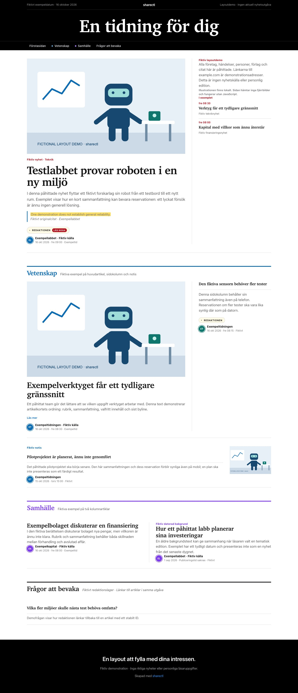

# sharectl

**Your AI agent makes you a personal newspaper, from the sources and interests you choose.**

sharectl is an instruction-driven newspaper builder: Markdown tells the agent how to work, and an HTML template gives the newspaper its layout. The agent does the fetching, editing and assembly with its own tools. There is no application, backend, package installation or required build system. An optional Python standard-library checker helps validate the completed HTML.

## Get started

Paste this into an AI agent:

> Make me a newspaper using https://github.com/bowetter1/sharectl. Read SKILL.md first. Ask what topics and sources I want, then actually fetch the sources before writing any news.

Or include your choices directly:

> Make me a newspaper using https://github.com/bowetter1/sharectl. I want science, culture and local news, in my language. Find suitable sources, and leave out video and social media.

The agent needs a tool that opens URLs and reads their contents, or a shell with network access. A chat model without those tools should explain that it cannot fetch current news and stop. Search snippets and remembered news are not substitutes for fetched sources.

## How it works

1. You choose topics, sources and people, or ask the agent to choose sources for you.
2. The agent opens a real feed or other original source and checks its contents and dates before writing anything.
3. It selects relevant stories, checks the facts, and fills `template.html`.
4. You receive `index.html` to open in your browser, with links to the originals.
5. Tell the agent what to change. You can ask for a short preference summary to reuse in another chat.

The reader's language, interests and sources shape the paper. No country, publisher, topic or sport is required. Weather, sports, markets, video and social posts are optional and appear only when requested and accessible.

## For AI agents

Read [SKILL.md](SKILL.md). The essential sequence is **ask → fetch → verify → select → fill → show**.

- Actually open the RSS/Atom URL and read its items. Do not just describe how fetching would work.
- Every story must be supported by a source fetched during the current run.
- No headline or summary may go beyond the fetched evidence.
- A daily edition normally uses the last 48 hours; honor a different period if the reader requests one.
- Public feed excerpts may support short summaries when full articles are paywalled. Explain that limitation in the reply.
- If a source fails, leave it out and tell the reader. If no source can be verified, stop without inventing an edition.

[Source examples and discovery guidance](references/sources.md) help agents find feeds and handle publishers without them. [Behavioral checks](references/checks.md) describe how to assess an agent's actual output and tool calls. [Article snippets and the class glossary](references/articles.md) define the content contract; the optional [offline checker](references/validation.md) and tests catch structural regressions.

[International publisher examples](references/publishers.md) adds checked sources across regions and languages, including RDF feeds, stale-feed warnings and optional existing API/AI access. Read it when choosing sources; its publishers are examples, not defaults.

[Tech and sports feeds](references/tech-sport.md) offers checked topic-specific sources in several languages when the reader requests those subjects.

## Examples



**[examples/example.html](examples/example.html)** — Fictional layout demonstration. The example contains **fictional demonstration content**, not current news. Its subjects and sources illustrate the design; they are not defaults for the reader's newspaper.

**[examples/tech-ai-vc-edition.html](examples/tech-ai-vc-edition.html)** — Fictional Tech/AI/VC layout demonstration showing the optional **editor layer (Redaktionen)**, a separate attributed fictional quotation and a fictional expansion. All events, companies, publishers and prose are invented for this demo. Both examples use the exact CSS/scripts from `template.html` and local illustrations; their example.com links are demonstration addresses, not news sources. No reader edition or real publisher text is committed.

A separately hosted edition is available at [utgava.sharectl.com](https://utgava.sharectl.com/).

## What stays simple

- Plain HTML with inline CSS; no templating framework or server.
- Responsive newspaper layout with linked headlines and short summaries.
- Optional YouTube embeds load on click; the rest of the paper works without JavaScript.
- Preferences stay in the conversation when the host supports it. Memory across chats or agents is not guaranteed.
- No reader configuration or private preferences committed to this public repository.
- Short own summaries and original links are the default. RSS access alone is not permission to copy entire articles.
- New editions use new uniquely named folders; existing editions are revised only when requested.

## Upgrading an older skill

The workflow revision in `SKILL.md` is **2026-10-16**. The older `bowetter1/sharectl-edition` Python project and an installed skill named `sharectl-edition` use a different workflow (`config.json`, `python -m sharectl_edition`). This repository does not run those commands. When installing/updating a skill in your agent host, use this repository's complete `SKILL.md`, `template.html` and `references/` together, under the `sharectl` name. Follow the host's installation mechanism and verify the loaded skill's repository/revision; do not overwrite an unrelated installed skill. Existing private Python configs do not need to be committed or migrated to try this template workflow.

## Optional checks

Requires Python 3.10+, with no pip packages:

```sh
python3 -m unittest discover -s tests -v
python3 tools/check_edition.py examples/example.html --template template.html --allow-demo
python3 tools/check_edition.py examples/tech-ai-vc-edition.html --template template.html --allow-demo
# For a real completed edition, omit --allow-demo:
python3 tools/check_edition.py /path/to/index.html --template template.html
```

The checker detects placeholders, missing internal targets/assets, inaccessible links, date-window errors and template changes. With an optional private source record it checks matching evidence fields and duplicate recorded events. It does not fetch news, prove accuracy/rights, check external link availability or replace browser QA. See the [validation guide](references/validation.md). Repository CI runs these offline checks without depending on publisher availability.

## Files

- `SKILL.md` — How the AI builds and checks a newspaper.
- `template.html` — The supplied HTML layout.
- `references/sources.md` — Feed discovery, tested examples and optional data sources.
- `references/publishers.md` — International feed examples, observed limitations and existing publisher APIs/AI access.
- `references/tech-sport.md` — Technology and sports feeds, coverage and observed limitations.
- `references/editor.md` — Optional editor layer: fact-checks, ratings, context, and voice guidelines.
- `references/checks.md` — Manual behavioral checks for agents.
- `references/articles.md` — Canonical article snippets, identifiers, source-record format and class glossary.
- `references/validation.md` — Optional checker usage, demo mode and limitations.
- `tools/check_edition.py`, `tests/` — Dependency-free offline validation and regression tests.
- `examples/` — Entirely fictional layout demos and local illustrations.
- `LICENSE` — MIT license.

Made by [Bo Wetter](https://sharectl.com) and contributors. [MIT license](LICENSE).
